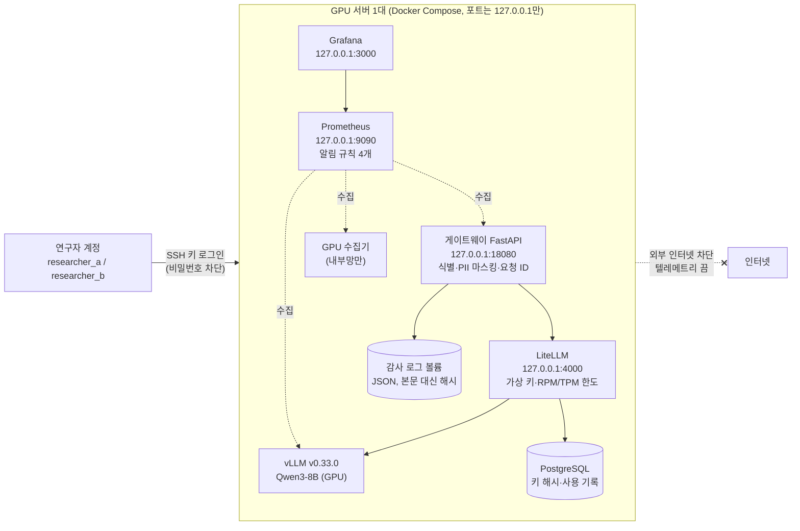

# hospital-llm-platform

폐쇄망 병원 연구 환경을 가정한 사내 LLM 서빙 플랫폼(단일 GPU 서버, 연구자 계정 분리)

vLLM(Qwen3-8B) 앞에 LiteLLM(키·한도)과 FastAPI 게이트웨이(식별·PII 마스킹·감사 로그)를 두었다. Docker Compose로 배포하고 Prometheus/Grafana로 운영한다.

## 핵심 숫자

- 동시 사용자 32명 부하에서 실패 0%, RPS 12.96, p95 1.5초, 생성 1,620토큰/초 ([loadtest.md](docs/loadtest.md))
- 인터넷 차단 상태에서 스택 재기동 61초, whoami와 chat 200 ([offline.md](docs/offline.md))
- vLLM 중단 후 알림 VLLMDown pending 25초, firing 85초 ([alerts.md](docs/alerts.md), [증거](evidence/day4/alert-vllmdown.txt))
- 장애 재현 2건: vLLM 강제 종료 중단 124초, GPU 메모리 부족 101초 ([incidents](docs/incidents/README.md))
- 백업 14초, 임시 컨테이너 복구 시험 11초에 9/9 일치 ([backup.md](docs/backup.md))
- DB 덤프 안의 실제 API 키 문자열 0건(키는 해시로만 저장) ([증거](evidence/day4/backup-key-check.txt))

## 아키텍처

## 필수 자격 대응

| 자격 | 이 저장소에서 한 일 | 증거 |
|---|---|---|
| Linux 운영·장애 분석 | SSH 키 인증만 허용, 관리자·연구자 그룹 분리, 장애 2건 재현과 원인 분석 | [day1-log.md](docs/day1-log.md), [security.md](docs/security.md), [incidents/](docs/incidents/README.md) |
| 백엔드 FastAPI | 인증·식별·PII 마스킹·감사 로그·지표를 갖춘 게이트웨이, 테스트 53개 통과 | [app/](app/), [tests/](tests/), [day3-log.md](docs/day3-log.md) |
| REST API 연동·디버깅 | OpenAI 호환 API를 LiteLLM으로 중계, 오류 5종(401×2, 429, 502, 504) 재현과 요청 ID 추적 | [api-errors.md](docs/api-errors.md), [day2-log.md](docs/day2-log.md) |
| Docker 배포·운영 | 7개 서비스 Compose, 비root 게이트웨이 이미지(uid 10001), 폐쇄망 기동, 백업·복구 | [compose.yaml](compose.yaml), [Dockerfile](Dockerfile), [offline.md](docs/offline.md), [backup.md](docs/backup.md) |
| Git | 일차별 브랜치 → PR 3개 병합 → 태그 3개, gitleaks로 비밀정보 검사 | [check_secrets.sh](scripts/check_secrets.sh), [개발 과정](#개발-과정) |
| 접근권한·비밀정보·로그 관리 | 키별 한도 정책, 본인 키로 식별(마스터 키 미사용), 감사 로그 17필드, 덤프 안 키 0건 | [security.md](docs/security.md), [quota-policy.md](docs/quota-policy.md), [backup-key-check.txt](evidence/day4/backup-key-check.txt) |

## 구성 요소

| 서비스 | 이미지:태그 | 포트 | 역할 |
|---|---|---|---|
| vllm | vllm/vllm-openai:v0.33.0 | 없음(내부망) | Qwen3-8B 추론, max-model-len 8192, gpu-memory-utilization 0.85 |
| litellm | ghcr.io/berriai/litellm@sha256:ef79…2035 (digest 고정) | 127.0.0.1:4000 | 가상 키, RPM/TPM 한도, 사용량 집계 |
| db (litellm-db) | postgres:16.16 | 없음(내부망) | LiteLLM 키 해시·사용 기록 저장 |
| gateway (llm-gateway) | llm-gateway:day2 (저장소 Dockerfile로 빌드) | 127.0.0.1:18080 | 인증·식별, PII 마스킹, 감사 로그, /metrics |
| prometheus | prom/prometheus:v3.15.1 | 127.0.0.1:9090 | 지표 수집(15일·5GB 보존), 알림 규칙 |
| gpu-exporter | utkuozdemir/nvidia_gpu_exporter:1.17.0 | 없음(내부망) | GPU 사용률·메모리·온도·전력 |
| grafana | grafana/grafana:13.3.1 | 127.0.0.1:3000 | 대시보드(패널 16개, 코드로 프로비저닝) |

출처: 이미지·포트·vLLM 설정은 [compose.yaml](compose.yaml), 보존 기간은 [security.md](docs/security.md), 패널 수는 [day3-log.md](docs/day3-log.md)에 있다.

## 빠른 시작

1. 요구 사항: NVIDIA GPU(32GB에서 검증), NVIDIA 드라이버, Docker와 Compose v2, NVIDIA Container Toolkit. 모델 파일은 `/srv/models/Qwen3-8B`에 둔다.
2. 환경 파일: `cp .env.example .env`를 실행하고 `<마스터 키>`, `<salt 키>`, `<DB 비밀번호>`, `<Grafana 비밀번호>`를 채운다(권한 600).
3. 기동: `docker compose up -d`. 게이트웨이 이미지는 이때 빌드된다.
4. 키 발급: `./scripts/issue_keys.sh`. 키는 `~/llm-keys/<계정>.key`(600)에 저장되고 화면에는 나오지 않는다.
5. 확인: `curl -s -H "Authorization: Bearer $(cat ~/llm-keys/<계정>.key)" http://127.0.0.1:18080/v1/whoami`
6. 대시보드: 브라우저에서 http://127.0.0.1:3000에 접속한다(admin / `.env`의 Grafana 비밀번호). 알림은 http://127.0.0.1:9090/alerts에서 본다.

## 운영

- 모니터링·알림: VLLMDown, GatewayDown, GPUHighTemperature, KVCacheHigh 규칙과 확인 방법 → [alerts.md](docs/alerts.md)
- 부하 시험: Locust로 동시 사용자 1/8/32명 측정, 용량 근거 → [loadtest.md](docs/loadtest.md), [quota-policy.md](docs/quota-policy.md)
- 장애 대응: 타임라인·탐지·원인·조치·재발 방지 보고서 → [incidents/](docs/incidents/README.md)
- 백업·복구: `scripts/backup.sh`, `scripts/restore_test.sh`, 운영 복구 절차 → [backup.md](docs/backup.md)
- 폐쇄망: `scripts/offline_check.sh`, 끈 텔레메트리, 반입 절차 → [offline.md](docs/offline.md)
- 시연 순서: [docs/demo.md](docs/demo.md)

## 보안 설계 요약

- 호스트 포트는 모두 127.0.0.1에만 연다. vLLM, PostgreSQL, GPU 수집기는 호스트 포트가 없다.
- 게이트웨이는 마스터 키를 갖지 않는다. 요청자 본인 키로 LiteLLM `/key/info`를 불러 계정을 식별한다.
- 주민번호, 전화번호, 환자번호(키워드 포함), 이메일을 업스트림에 보내기 전에 마스킹한다.
- 감사 로그에는 프롬프트 본문 대신 마스킹 후 sha256만 남긴다. 키 원문과 Authorization 헤더는 남기지 않는다.
- vLLM, LiteLLM, Grafana의 사용 통계와 외부 조회를 env로 껐다.

자세한 내용은 [security.md](docs/security.md)에 있다.

## 개발 과정

| 일차 | 주제 | 태그 | 작업 기록 |
|---|---|---|---|
| 1일차 | 서버 점검, 계정·SSH 강화, vLLM·LiteLLM 기동, 계정별 키와 429 | v0.1-day1 | [day1-log.md](docs/day1-log.md) |
| 2일차 | FastAPI 게이트웨이: 식별, PII 마스킹, 감사 로그, Docker화, 오류 재현 | v0.2-day2 | [day2-log.md](docs/day2-log.md) |
| 3일차 | 지표, Prometheus, Grafana, 부하 시험, 장애 재현 보고서 | v0.3-day3 | [day3-log.md](docs/day3-log.md) |
| 4일차 | 알림 규칙, 한도 정책, 텔레메트리 끄기, 폐쇄망 시험, 백업·복구, 문서 | (진행 중) | [day4-log.md](docs/day4-log.md) |

작업 방식: 단계마다 계획 → 실행 → 검증(판정 표) → 기록 → 커밋 순서로 진행했다. 전체 문서 목차는 [docs/README.md](docs/README.md)에 있다.

## 한계와 향후 개선

- GPU 서버 1대 구성이다. 다중 GPU·다중 노드, SSO, 비밀정보 저장소는 설계안만 있다 → [scale-out.md](docs/scale-out.md)
- 모델 응답은 마스킹하지 않는다. 게이트웨이·vLLM의 /metrics는 인증 없이 내부망에서 열려 있다([security.md](docs/security.md)).
- 키를 폐기해도 게이트웨이 식별 캐시 때문에 최대 300초 동안 예전 계정으로 기록될 수 있다(요청 차단은 LiteLLM이 한다)([security.md](docs/security.md)).
- 백업이 운영과 같은 디스크에 있다. Grafana 백업 122 MiB 중 대부분이 플러그인이라, 플러그인을 빼면 크게 줄일 수 있다(grafana.db는 1.7 MiB)([backup.md](docs/backup.md)).
