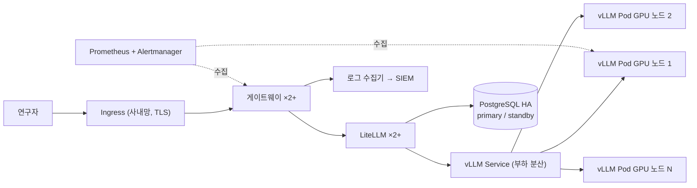

# 확장 설계안 (다중 GPU·다중 노드·SSO)

**이 문서는 설계안이다. 이 저장소에서 구현하지 않았다.**

각 절은 현재 상태 → 확장안 → 전환 기준(숫자) 순서로 쓴다. 현재 상태의 숫자는 실측 문서에서 가져왔다. 확장안의 숫자 가운데 "가정"이라고 표시한 것은 측정값이 아니다.

## 1. 용량 계획

- **현재:** GPU 1장(RTX 5090 32GB)에 Qwen3-8B를 올렸다. 3일차 실측 생성 처리량은 1,620토큰/초(분당 약 97,000토큰)다([loadtest.md](loadtest.md)). 연구자 TPM 합계는 그 70%인 약 68,000으로 묶었고, 표준 연구자(TPM 20,000)는 GPU 1장당 3명까지다([quota-policy.md](quota-policy.md)).
- **확장안 공식:**

  필요 GPU 수 = ⌈ N × TPM_연구자 × c ÷ (97,000 × 0.7) ⌉ = ⌈ N × 20,000 × c ÷ 68,000 ⌉

  - N: 표준 연구자 수
  - c: 동시에 한도까지 쓰는 비율. c = 1은 지금 정책처럼 모두가 동시에 한도까지 쓴다고 보는 최악의 경우다.

| 연구자 수 | c = 1 (현재 정책, 보수적) | c = 0.3 (가정) |
|---|---|---|
| 30명 | ⌈30 × 20,000 ÷ 68,000⌉ = 9 GPU | ⌈9 × 20,000 ÷ 68,000⌉ = 3 GPU |
| 100명 | ⌈100 × 20,000 ÷ 68,000⌉ = 30 GPU | ⌈30 × 20,000 ÷ 68,000⌉ = 9 GPU |

- 주의: 1,620토큰/초는 짧은 요청(입력 약 30토큰, 출력 최대 128토큰)으로 잰 값이다. 긴 문서 요약처럼 입력이 길면 처리량이 떨어진다. 확장하기 전에 실제 요청 분포로 다시 측정한다.
- **전환 기준:**
  - 연구자 TPM 합계가 68,000을 넘으면 GPU를 늘린다.
  - 또는 GPU 사용률이 평균 90% 이상이고 `vllm:num_requests_waiting`이 0보다 큰 상태가 하루 1시간 넘게 이어지면 늘린다. 3일차에는 32명에서도 대기 0이었다.

## 2. 단일 노드 다중 GPU

- **현재:** vLLM 1개가 GPU 1장을 쓴다(`gpu-memory-utilization 0.85`).
- **확장안:**
  - 같은 모델을 GPU마다 1개씩 띄우고(복제), LiteLLM의 같은 model group에 여러 `api_base`로 등록해 부하를 나눈다. 8B 모델은 GPU 1장에 들어가므로 이 방식이 가장 단순하다.
  - 큰 모델(예: 70B급)은 `--tensor-parallel-size N`으로 GPU N장에 나눠 올린다.
  - 모델별로 GPU를 따로 배정한다(예: 0번 범용 모델, 1번 임베딩·코드 모델). `CUDA_VISIBLE_DEVICES`나 compose `device_ids`로 고정한다.
- **전환 기준:** GPU 1장으로 1절 공식의 필요 수를 못 채울 때 바꾼다. 또는 KV 캐시 사용률이 지속적으로 90%를 넘을 때 바꾼다(알림 KVCacheHigh).

## 3. 다중 노드 (Kubernetes)

- **현재:** Docker Compose로 서버 1대에 7개 서비스를 띄운다.
- **확장안:**
  - Kubernetes에 NVIDIA GPU Operator를 설치해 드라이버, 컨테이너 런타임, GPU 지표를 관리한다.
  - vLLM은 모델별 Deployment로 띄운다(무상태, 모델 파일은 노드 로컬 또는 읽기 전용 PV). 그 앞에 Service로 부하를 나누고, readiness는 `/health`로 확인한다.
  - LiteLLM과 게이트웨이는 무상태라 Deployment를 2개 이상 복제하고 Ingress 뒤에 둔다.
  - PostgreSQL은 고가용성 구성(예: 운영자 기반 primary/standby와 자동 장애 조치)으로 바꾼다. 감사 로그는 파일 대신 로그 수집기로 보낸다(6절).

- **전환 기준:** 1절 공식으로 필요한 GPU가 서버 1대에 넣을 수 있는 수(예: 8장)를 넘을 때 바꾼다. 또는 서비스 중단 허용 시간이 단일 서버로는 못 맞출 만큼 짧아질 때 바꾼다. 현재 장애 재현에서 중단 시간은 101~124초였다([incidents](incidents/README.md)).

## 4. 인증 SSO

- **현재:** 연구자마다 LiteLLM 가상 키를 발급한다(`scripts/issue_keys.sh`, 30일 만료). 게이트웨이는 그 키로 `/key/info`를 불러 계정을 식별한다.
- **확장안:** 사내 IdP(OIDC, 예: Keycloak)로 로그인한다. 게이트웨이가 JWT 서명, 만료, audience를 검증한다. 토큰의 그룹 클레임(예: `llm-researcher-standard`)을 LiteLLM 팀에 연결하고, 팀에 RPM/TPM 한도를 건다.
- **옮기는 단계:**
  1. 게이트웨이에 JWT 검증을 추가하고, 지금의 키 방식과 함께 받는다. 감사 로그 `user_id`는 IdP의 subject로 기록한다.
  2. LiteLLM에 역할별 팀(관리자, 표준 연구자, 제한 연구자)을 만들고 [quota-policy.md](quota-policy.md)의 한도를 옮긴다. 게이트웨이는 팀용 내부 키로 중계한다.
  3. 모든 연구자가 SSO로 옮긴 것을 확인한 뒤 개인 가상 키 발급을 멈추고, 남은 키를 만료시키거나 폐기한다.
- **전환 기준:** 연구자가 10명을 넘거나, 퇴사·전보 때 권한을 회수하는 일을 인사 시스템과 맞춰야 할 때 바꾼다(가정).

## 5. 비밀정보

- **현재:** `.env`(600, Git 제외)에 마스터 키, salt 키, DB 비밀번호, Grafana 비밀번호를 둔다. 키 파일은 `~/llm-keys`(700/600)에 있다.
- **확장안:**
  - HashiCorp Vault 또는 Kubernetes Secret(etcd 암호화와 외부 KMS)에 둔다. 서비스는 실행 중에 주입받는다.
  - DB 비밀번호는 Vault의 동적 자격 증명으로 자동 교체한다. 가상 키는 SSO로 옮기면 없앨 수 있다.
  - `LITELLM_SALT_KEY`는 바꾸면 DB에 암호화된 값을 풀 수 없다. 그래서 교체 절차를 따로 정한다([backup.md](backup.md)).
- **전환 기준:** 운영자가 2명 이상이 되거나 서버가 2대 이상이 되면 바꾼다. `.env` 사본이 퍼지는 것을 막기 위해서다.

## 6. 관측

- **현재:** Prometheus 알림 규칙 4개가 상태를 계산만 하고 발송처는 없다([alerts.md](alerts.md)). 감사 로그는 볼륨 안 파일로 쌓인다(10MB × 5 회전).
- **확장안:**
  - Alertmanager를 추가해 사내 메일(SMTP)이나 메신저 웹훅으로 보낸다. critical은 즉시, warning은 묶어서 보낸다.
  - 로그는 Loki 같은 수집기로 모은다.
  - 감사 로그는 보안 관제(SIEM)로 보내 이상 사용(대량 요청, PII 마스킹 급증)을 탐지한다.
- **전환 기준:** 근무 시간 밖에도 대응해야 하거나, 서버가 2대 이상이 되면 바꾼다.

## 7. 폐쇄망 공급망

- **현재:** 이미지 7개를 미리 받아 두었다(LiteLLM은 digest로 고정). 모델 파일은 `/srv/models`에 직접 복사했다. 반입 절차는 [offline.md](offline.md)에 있다.
- **확장안:**
  - 사내 컨테이너 레지스트리(예: Harbor)에 이미지를 올린다. 이미지 서명(cosign)을 검증하고 취약점 검사(Trivy 등)를 통과한 것만 배포한다.
  - 모델 파일은 반입할 때 SHA-256 해시를 대조하고, 사내 객체 저장소에 버전별로 보관한다.
- **전환 기준:** 노드가 2대 이상이 되거나, 보안 심의에서 이미지 출처 증명을 요구하면 바꾼다.

## 8. 백업

- **현재:** `scripts/backup.sh`로 운영과 같은 디스크(`~/llm-backups`)에 백업한다. 복구 시험은 9/9 일치, 11초였다([backup.md](backup.md)).
- **확장안:**
  - 백업을 별도 저장소(NAS, 외부 매체)로 복사하고 암호화한다(예: age, GPG). 보관 정책은 일 7개, 주 4개로 한다(가정).
  - 매달 `scripts/restore_test.sh`로 복구 훈련을 하고 결과를 기록한다.
- **전환 기준:** 실제 연구자 데이터가 쌓이기 시작하면 바로 바꾼다. 같은 디스크 백업은 디스크 고장을 막지 못한다.

## 9. 우선순위

| 항목 | 필요 시점 | 난이도 | 선행 조건 |
|---|---|---|---|
| 백업 별도 저장소·암호화 | 실사용 시작 전 | 하 | 사내 NAS 또는 외부 매체 |
| Alertmanager 발송 | 실사용 시작 전 | 하 | 사내 메일 서버나 메신저 웹훅 주소 |
| 단일 노드 다중 GPU(복제) | 연구자 TPM 합계 68,000 초과 | 중 | GPU 추가, 실제 요청 분포로 재측정 |
| SSO(OIDC) | 연구자 10명 초과(가정) | 중 | 사내 IdP와 그룹 체계 |
| 비밀정보 저장소 | 운영자 2명 이상 또는 서버 2대 이상 | 중 | Vault 또는 K8s 도입 |
| 사내 레지스트리·이미지 서명 | 노드 2대 이상 | 중 | 레지스트리 서버, 보안 심의 기준 |
| Kubernetes 다중 노드 | 서버 1대 GPU 상한 초과 | 상 | GPU Operator, HA DB, 사내 Ingress·인증서 |
